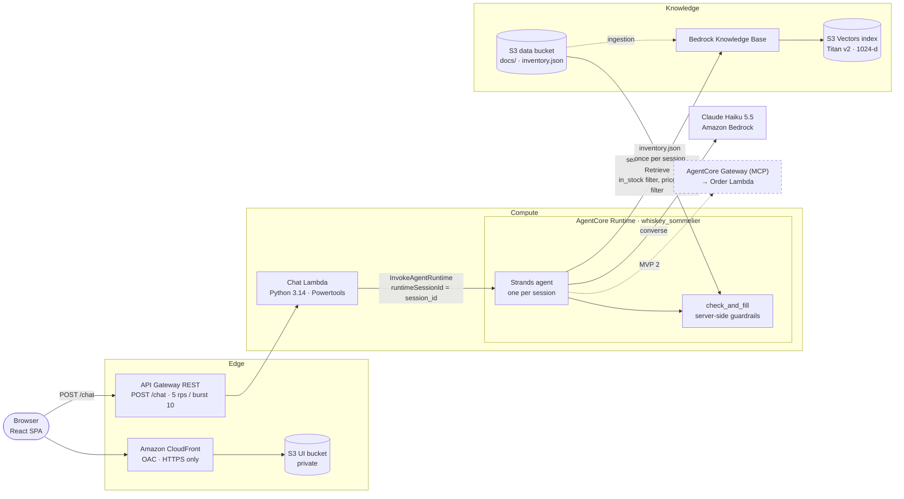

# Architecture



## Request lifecycle (recommend)

1. The UI generates a UUID4 `session_id` on page load (and on *New conversation*) and sends a warm-up request so cold starts are paid before the first question.
2. `POST /chat` hits API Gateway (throttling, CORS) and the chat Lambda, which validates the request with Pydantic and calls `InvokeAgentRuntime` with `runtimeSessionId = session_id`.
3. AgentCore Runtime routes the call to that session's isolated microVM. The first call creates it; later calls reuse it until it idles out, which is where the per-session Strands agent and its conversation live.
4. The agent calls `search_inventory` (Bedrock KB `Retrieve` with the in-stock filter always on, plus `price_level <= n` when the user has a budget or says "cheaper"), then returns a structured `AgentAnswer`: a short message and up to 3 picks of `{id, match_score, why, serving}`.
5. `check_and_fill` drops unknown, out-of-stock and duplicate ids and anything under the score threshold, clamps and re-sorts, cuts to N, fills each card from `inventory.json` and validates the final `ChatResponse`.
6. The JSON goes back through the Lambda to the browser, which renders ranked cards.

## Response contract

The UI depends only on this shape (requirements spec §4):

```json
{
  "session_id": "3f6c1d2e-8a4b-4c1e-9f7a-2b5d8e0c4a91",
  "message": "A rainy Sunday and a good book call for something slow and warming.",
  "matches": [
    {
      "rank": 1, "id": "lagavulin-16", "match_score": 92,
      "why": "You described a slow, rainy day indoors. Lagavulin's deep peat smoke ...",
      "serving": "Neat, with a few drops of water after the first sip.",
      "whiskey": { "name": "Lagavulin 16 Year Old", "region": "Islay", "price_tier": "$$$", "...": "..." }
    }
  ],
  "pending_order": null,
  "order": null
}
```

Errors always use `{ "error": { "code", "message" } }` with `INVALID_REQUEST` (400), `THROTTLED` (429), `TIMEOUT` (504) or `AGENT_ERROR` (500), including the ones API Gateway produces itself (gateway responses carry the same body and CORS headers).

## Knowledge base

- **Source of truth:** `kb/` holds one markdown file per whiskey (YAML frontmatter + prose: Description, Tasting Notes, Story, Best For). 59 bottles, 3 deliberately out of stock.
- **`make kb-sync`** validates every file, writes a `<id>.md.metadata.json` sidecar (`id`, `in_stock`, `price_level`, `price_tier`, `type`, `country`, `rating`), builds `inventory.json`, uploads to the data bucket and runs ingestion until it completes.
- **One chunk per bottle** (chunking `NONE`), so each search hit is exactly one whiskey.
- **S3 Vectors** with Bedrock's text and metadata keys configured as non-filterable, which avoids the 2 KB filterable-metadata limit.

## Repository layout

```text
.
├── app.py                    # CDK entry
├── cdk/whiskey/              # one stack: KB, agent runtime, chat API, UI hosting, secure_bucket helper
├── agent/                    # AgentCore Runtime code (built into build/agent with ARM64 wheels)
│   ├── main.py               # BedrockAgentCoreApp entrypoint, sessions, warm-up, error mapping
│   ├── observability.py      # starts ADOT (OpenTelemetry) for AgentCore Observability
│   ├── sommelier.py          # builds the agent from its modes, runs a turn, logs one JSON line per turn
│   ├── contract.py           # ChatResponse - the API contract
│   ├── answer.py             # AgentAnswer - what the LLM returns
│   ├── prompts/base.md       # persona, safety, mode routing
│   └── recommend/            # MODE 1: search_inventory tool, check_and_fill, prompt + rubric
├── service/chat/             # chat Lambda (Powertools, Pydantic models)
├── scripts/                  # kb_sync, chat_cli (demo fallback), clean_logs, enable_observability
├── kb/                       # the inventory
├── ui/                       # React + Vite + Tailwind
└── tests/
    ├── unit/                 # checks, filters, kb-sync, handler, rollback - no AWS
    └── e2e/                  # deepeval golden set (golden.yaml, metrics.py) against the deployed API
```

## Observability

- **Traces:** the agent starts the AWS Distro for OpenTelemetry (ADOT) in-process (`agent/observability.py`) before boto3 and Strands load; AgentCore Runtime supplies the exporter settings, and Strands emits GenAI spans for each model call and tool call. Runtime tracing is enabled in CDK. Spans land in CloudWatch through Transaction Search (`make observability`, once per account) and appear under **CloudWatch → GenAI Observability → Bedrock AgentCore**.
- **Turn logs:** one JSON line per turn in the runtime log group: input, retrieved ids, raw picks and scores, dropped ids and reasons, tool calls, latency.
- **Lambda logs:** Powertools structured logs with `session_id` as the correlation id.

## Security

- No authentication by design for the hackathon (phase 3 adds Cognito). Cost is bounded by API Gateway throttling and the 500-character message limit.
- Every S3 bucket goes through one `secure_bucket` helper: Block Public Access, TLS-only bucket policy, SSE-S3, ACLs disabled. The UI bucket is readable only by the CloudFront distribution (OAC).
- Least-privilege IAM: the agent role can invoke only the Haiku/Sonnet inference profiles and their foundation models, `Retrieve` on the one KB and read only `inventory/inventory.json`. The chat Lambda can only invoke the one runtime.
